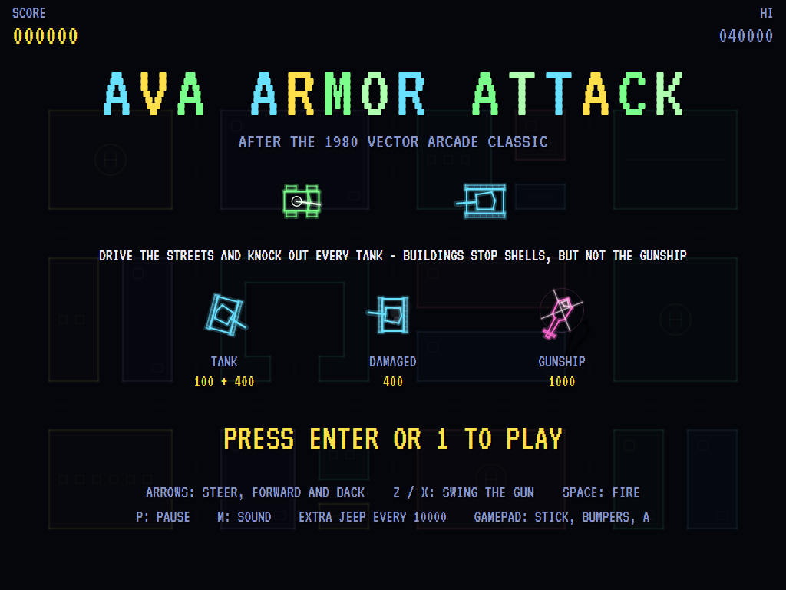
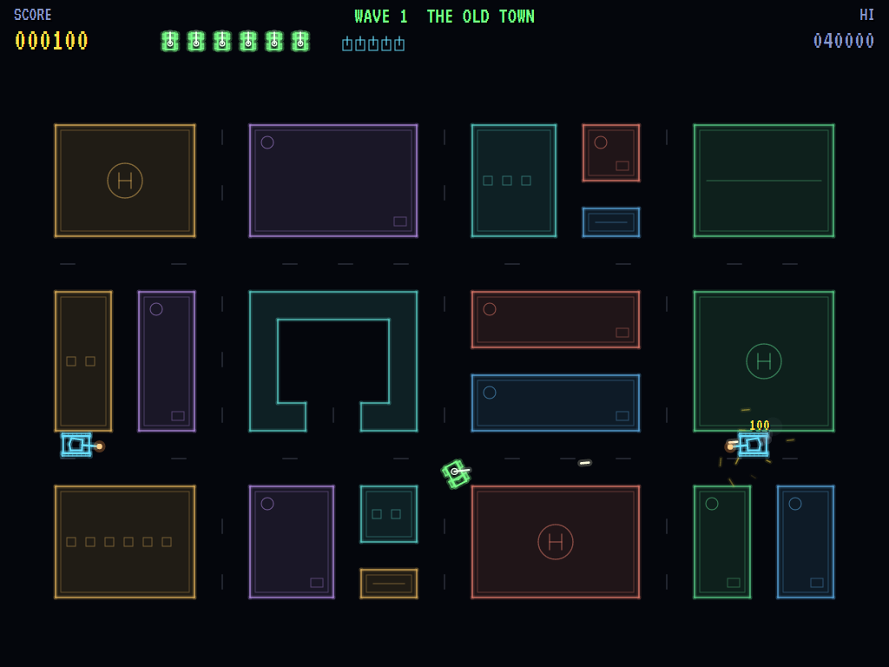
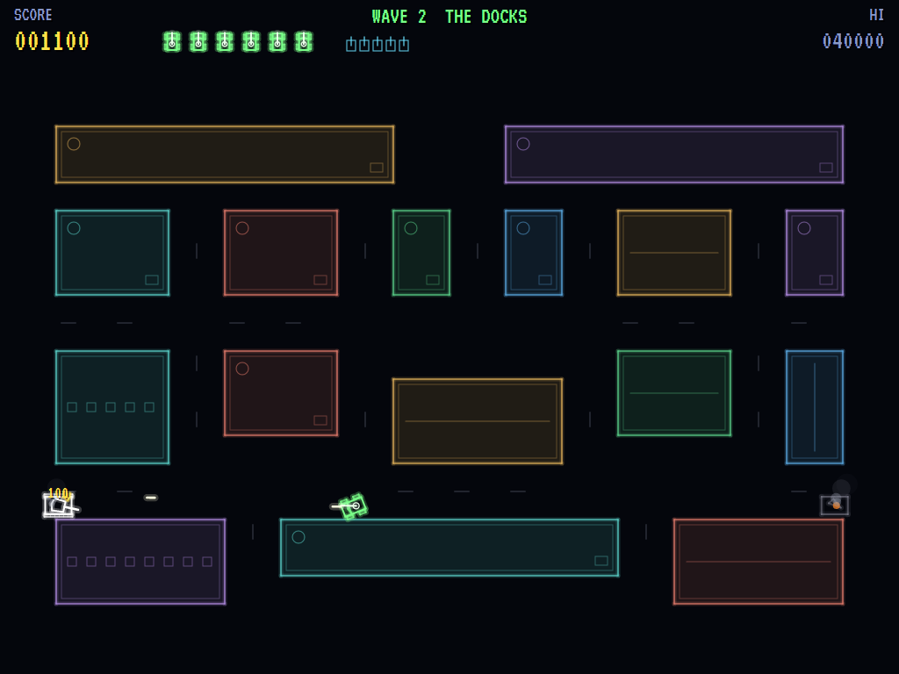
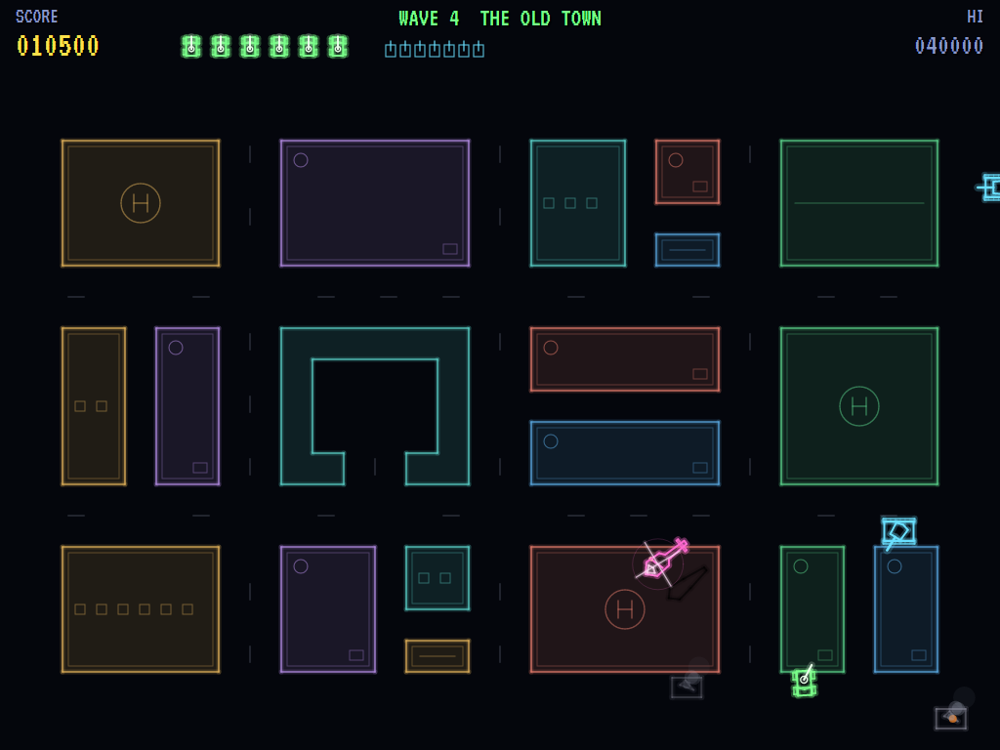
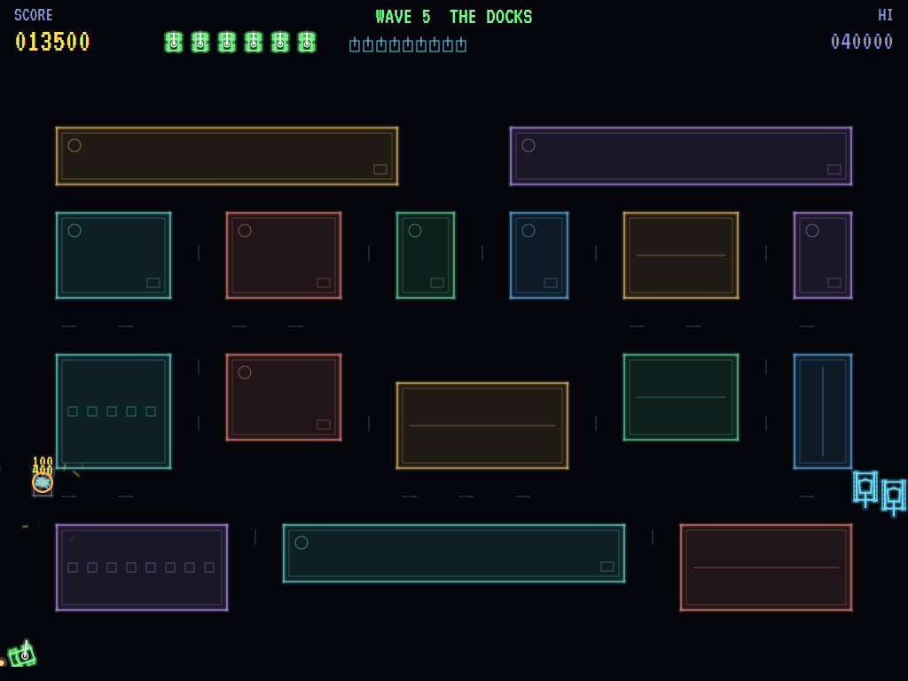
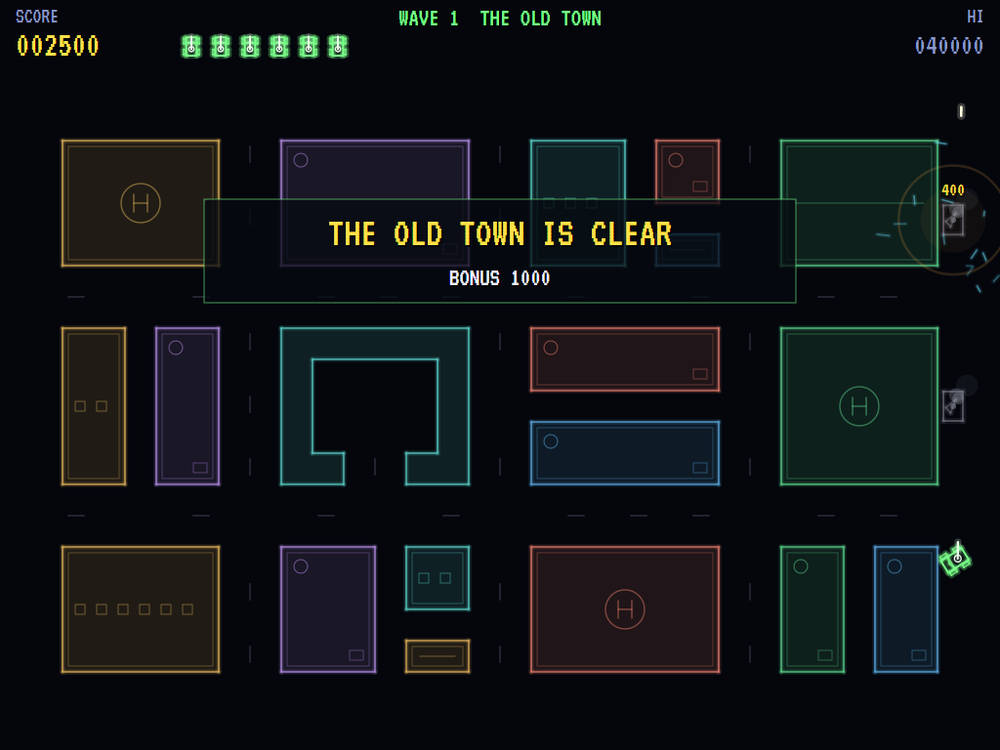
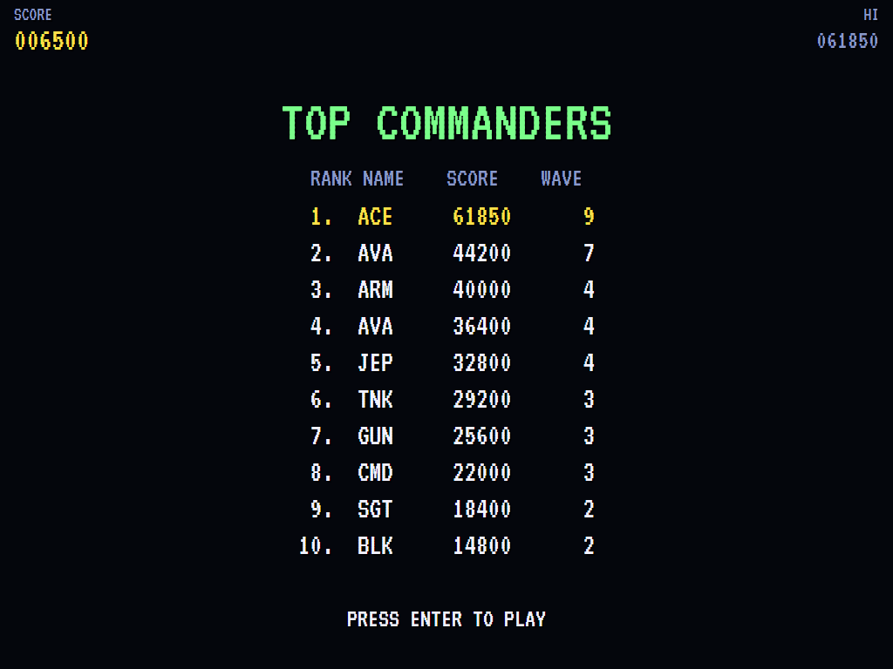

# AVA Armor Attack

[](https://github.com/Harlock123/AVAArmorAttack/actions/workflows/build.yml)

A colour vector tank battle in the style of Cinematronics' 1980 arcade game **Armor Attack**, built with
.NET 10 and Avalonia UI. Drive a jeep through a city seen from above, its buildings washed in colour like
the overlay on the old vector cabinet. Tanks roll in from the sides and hunt you along the streets, and a
gunship comes over the rooftops. The buildings are your cover: they stop your shells and the tanks' alike.
The gunship's rockets fly straight over them, though.

## Features

- **The jeep** steers and drives like a car: forward, back and turning on the spot. Its gun swivels on its
  own, so you can drive one way and shoot another. Two shells in the air at once, at most.
- **The city**: three districts, each a grid of streets and buildings, taken in turn:
  - **The Old Town:** tight blocks, alleys and a courtyard.
  - **The Docks:** long warehouses and wide quays.
  - **The Plaza:** an open square round a monument.
- **The tanks** roll in from the sides of the city, a few at a time, and hunt you along the streets.
  - A tank turns its turret slowly, but it follows you even through the buildings, so its gun is already
    on you when you come round the corner.
  - It fires only with a clear line, and stops to fire once it has you close.
  - Two hits: the first (100) wrecks its engine, so it smokes and crawls at half speed. The second (400)
    finishes it.
  - Run into one and you're crushed.
- **Your shell can stop theirs**: shoot an incoming tank shell head-on and both are gone.
- **The gunship** (1000), from the second district, circles over the rooftops and fires bursts of rockets
  that no building stops. It flies off again if you don't bring it down.
- **Each district** brings more tanks, more at once, quicker and better shots. From the third, they allow
  for where you're going when they aim. Clearing a district pays a bonus, and there's an extra jeep every
  10000.
- **The attract mode** plays itself through each district in turn. The computer player:
  - finds a street corner with a clear shot at a tank, away from the other tanks' guns, and drives there
    along the streets
  - keeps its gun on whatever it can see, leading it
  - swerves out of the way of the shells it sees coming
- **The sounds** are all synthesised: the jeep's gun, the tanks' boom, a clang on the armour, ricochets,
  rumbling tracks, the gunship's rotor and rockets, and a marching title theme.

## Screenshots

| The title | The Old Town | The Docks |
|:---------:|:------------:|:---------:|
|  |  |  |
| The enemy, and the points. | Tanks rolling in, and a shell on its way. | A damaged tank smoking, and a wreck. |

| The gunship | A tank destroyed | A district cleared |
|:-----------:|:----------------:|:------------------:|
|  |  |  |
| Rockets over the rooftops. | Knocked out. | The bonus, then the next district. |

| The high scores | | |
|:---------------:|:-:|:-:|
|  | | |
| The top commanders. | | |

The screenshots are made by the tests, which play the game in a real (headless) window; see
[Tests](#tests).

## Download and run

Ready-to-run builds for Windows, macOS and Linux, on both Intel/AMD and ARM, are on the
[Releases page](https://github.com/Harlock123/AVAArmorAttack/releases/tag/latest). **Latest build** is
rebuilt on every push to `main`. Each download is one self-contained executable: no .NET install is
needed.

| Platform | Archive |
|---|---|
| Windows | `AVAArmorAttack-win-x64.zip`, `AVAArmorAttack-win-x86.zip`, `AVAArmorAttack-win-arm64.zip` |
| macOS | `AVAArmorAttack-osx-arm64.tar.gz` (Apple silicon), `AVAArmorAttack-osx-x64.tar.gz` (Intel) |
| Linux | `AVAArmorAttack-linux-x64.tar.gz`, `AVAArmorAttack-linux-arm64.tar.gz`, `AVAArmorAttack-linux-arm.tar.gz` |

```bash
tar -xzf AVAArmorAttack-linux-x64.tar.gz     # or linux-arm64, linux-arm, osx-arm64, osx-x64
./AVAArmorAttack
```

On Windows, unzip and run `AVAArmorAttack.exe`. On macOS, if Gatekeeper refuses to open it, run
`xattr -d com.apple.quarantine AVAArmorAttack` once. Run with `--no-audio` for silence.

**Sound** comes through OpenAL Soft, built in for every platform. In a virtual machine the game
detects it and uses a larger audio buffer, so the sound doesn't break up.

**Gamepads** use SDL2, which is bundled for Windows, macOS and Intel/AMD Linux. ARM Linux builds need it
installed; without it the keyboard still works:

```bash
sudo apt install libsdl2-dev            # Debian / Ubuntu / Raspberry Pi OS
sudo pacman -S --needed sdl2-compat     # Arch / Omarchy
```

## Controls

| Action | Keyboard | Gamepad |
|---|---|---|
| Start | Enter or 1 | Start |
| Steer | Left / Right (or A / D) | Left stick / D-pad |
| Drive forward / back | Up / Down (or W / S) | Up / Down (or B for forward) |
| Swing the gun | Z / X (or Q / E, comma / full stop) | Bumpers or right stick |
| Fire | Space or Ctrl | A or right trigger |
| Pause | P or Esc | Start |
| Quit (while paused) | Esc | Back |
| Sound on/off | M | |
| Screenshot | Ctrl+S (to your Pictures folder) | |

On the high-score table, type your initials, or use up/down and Space, then Enter.

## Tests

```bash
dotnet test AVAArmorAttack.slnx
```

The engine has no UI and runs in fixed 60 Hz steps, so it plays the same at any frame rate, and a seed
always plays the same game. The tests check:

- **The city:** every district's streets joining up, with a way in at each side; lines of fire clear down a
  street and blocked by a building
- **The jeep:**
  - turning, speeding up, coasting to a stop and reversing slower
  - stopping at buildings
  - the gun swinging on its own and turning with the jeep, and firing where it points
  - two shots at most, and buildings stopping them
- **The tanks:**
  - two hits to destroy, and half speed once damaged
  - turning the turret and firing with a clear line, and following the jeep through a building but holding
    fire
  - hunting along the streets without sharing a cell
  - running the jeep over (unless it's just come back)
  - rolling in from the sides a few at a time
  - more, faster and better shots each wave
- **The gunship:** rockets over the rooftops where shells stop, 1000 for shooting it down, and flying off in
  the end; a shot stopping a shell head-on
- **The machine:**
  - a new jeep back away from the tanks, and the last jeep ending the game
  - a district cleared, with its bonus, then on to the next
  - extra jeeps
  - the demonstrations touring the districts
  - starting a game, and initials for a high score
  - the computer player clearing the first district
  - the same game from the same seed, and pausing

The screenshot tests draw the real screen in a headless window. To refresh the README's pictures:

```bash
ARMOR_SHOTS=$PWD/Images dotnet test tests/AVAArmorAttack.Tests --filter ScreenshotTests
```

To see how the computer player gets on, district by district (for tuning; `1` for the pilot, `lazy` for one
that just drives in circles firing):

```bash
ARMOR_PROBE=1 dotnet test tests/AVAArmorAttack.Tests --filter PilotProbe --logger "console;verbosity=detailed"
```

## Building

```bash
dotnet build AVAArmorAttack.slnx
dotnet run --project src/AVAArmorAttack
```

Needs the .NET 10 SDK. The sounds are made by `tools/make_sounds.py` (standard-library Python):
`python3 tools/make_sounds.py` rewrites `src/AVAArmorAttack/Sounds`.

## Project structure

```
AVAArmorAttack/
├── AVAArmorAttack.slnx
├── src/AVAArmorAttack/
│   ├── Engine/
│   │   ├── GameEngine.cs        # States, the title and demo cycle, the gunship's rotor
│   │   ├── GameEngine.Play.cs   # The jeep and its gun, shells; the tanks, their hunt and their aim; the
│   │   │                        # gunship; districts and scoring
│   │   ├── JeepPilot.cs         # The computer player, for the demonstration (and the tests)
│   │   ├── Entities.cs          # The city's districts and its streets, the jeep, tanks and gunship
│   │   ├── HighScoreTable.cs, InitialsEntry.cs
│   │   ├── InputHandler.cs, ControllerManager.cs  # Keys and an SDL2 gamepad
│   │   └── SoundManager.cs      # Effects and the tunes through OpenAL
│   ├── Audio/                   # The OpenAL engine (from the author's AVABand)
│   ├── Views/                   # The vector drawing: the city, jeep, tanks, gunship and the screens
│   └── Sounds/                  # The synthesised effects and tunes
├── tests/AVAArmorAttack.Tests/  # Gameplay, screenshot and probe tests
├── tools/make_sounds.py
└── Images/                      # Screenshots
```

## About and licence

AVA Armor Attack © 2026 Lonnie Watson, under the [MIT License](LICENSE).

*Armor Attack* © 1980 Cinematronics; the name belongs to its current owner. AVA Armor Attack is an
independent, unofficial game in its style. Its city and districts, its jeep, tanks and gunship, its
graphics, sounds, tunes and code are its own; nothing is taken from the arcade machine's program, graphics,
sound or music. It is not affiliated with or endorsed by any rights holder.
